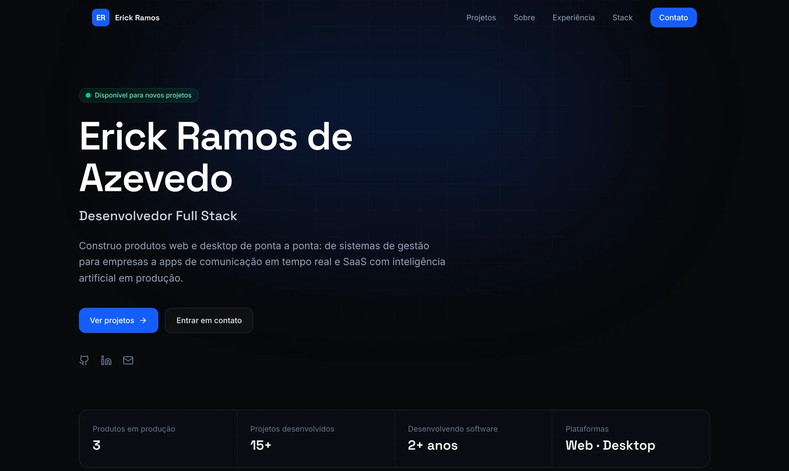
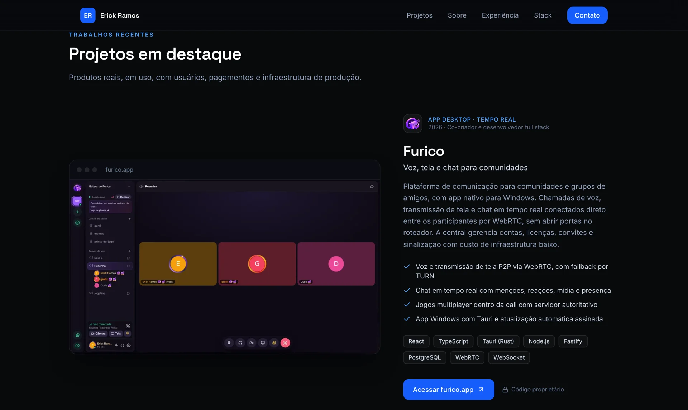

<div align="center">

# Erick Ramos — Portfólio

**Desenvolvedor Full Stack · Pelotas, RS**

Portfólio pessoal com meus principais projetos, experiência e stack.

[](https://react.dev)
[](https://www.typescriptlang.org)
[](https://vite.dev)
[](https://tailwindcss.com)
[](https://vercel.com)

[LinkedIn](https://www.linkedin.com/in/erickazevedoo/) · [GitHub](https://github.com/ErickRamos00) · [E-mail](mailto:erickramosdeazevedo@gmail.com) · [WhatsApp](https://wa.me/5553984397497)

<br />



</div>

---

## Sumário

- [Sobre o projeto](#sobre-o-projeto)
- [Funcionalidades](#funcionalidades)
- [Tecnologias](#tecnologias)
- [Como rodar localmente](#como-rodar-localmente)
- [Estrutura do projeto](#estrutura-do-projeto)
- [Como atualizar o conteúdo](#como-atualizar-o-conteúdo)
- [Deploy](#deploy)
- [Sobre mim](#sobre-mim)
- [Contato](#contato)

---

## Sobre o projeto

Este repositório é o meu portfólio profissional: uma página única, rápida e responsiva que apresenta quem eu sou, os produtos que desenvolvo e como entrar em contato.

A ideia foi construir algo com cara de produto, e não de modelo pronto. Por isso o visual é sóbrio, com tipografia legível, uma única cor de destaque e animações discretas. Cada projeto em destaque funciona como um pequeno estudo de caso, com contexto, papel, destaques técnicos, stack e link para o produto no ar.



## Funcionalidades

- **Projetos em destaque** em formato de estudo de caso, com imagem real do produto, papel, principais entregas, stack e link
- **Outros projetos** em cards compactos, com links para o código e para a versão publicada
- **Linha do tempo** de experiência profissional e formação acadêmica
- **Stack agrupada por área**: front-end, back-end, dados, infraestrutura e desktop
- **Contato direto** por WhatsApp, e-mail, LinkedIn e GitHub
- **Responsivo** do celular ao desktop, sem rolagem lateral
- **Acessibilidade**: HTML semântico, foco visível no teclado e respeito a `prefers-reduced-motion`
- **SEO e compartilhamento**: `lang="pt-BR"`, meta description e tags Open Graph
- **Métricas de acesso** com Vercel Analytics

## Tecnologias

| Camada | Ferramentas |
| --- | --- |
| Interface | React 19, TypeScript |
| Estilo | Tailwind CSS 4, fontes Inter, Space Grotesk e JetBrains Mono |
| Animações | Motion (Framer Motion) |
| Ícones | Lucide |
| Build | Vite 6 |
| Hospedagem e métricas | Vercel, Vercel Analytics |

## Como rodar localmente

**Pré-requisitos:** Node.js 20 ou superior e npm.

```bash
git clone https://github.com/ErickRamos00/Portf-lioErickRamos.git
cd Portf-lioErickRamos
npm install
npm run dev
```

O site abre em `http://localhost:3000`.

| Comando | O que faz |
| --- | --- |
| `npm run dev` | Servidor de desenvolvimento com recarga automática |
| `npm run build` | Gera a versão de produção em `dist/` |
| `npm run preview` | Serve localmente a versão de produção |
| `npm run lint` | Checagem de tipos com o TypeScript |

## Estrutura do projeto

```
.
├── docs/              # imagens usadas neste README
├── public/
│   └── projects/      # capas e logos dos projetos em destaque
├── src/
│   ├── App.tsx        # seções da página e dados (projetos, experiência, stack)
│   ├── index.css      # tema, fontes e componentes de estilo (Tailwind)
│   └── main.tsx       # ponto de entrada e Vercel Analytics
├── index.html         # título, metatags e favicon
└── vite.config.ts
```

## Como atualizar o conteúdo

Todo o conteúdo fica em listas no começo e no meio de `src/App.tsx`, então não é preciso mexer no layout:

| O que mudar | Onde |
| --- | --- |
| E-mail, WhatsApp, LinkedIn e GitHub | constante `CONTACT` |
| Projetos em destaque | lista `featured` (imagem em `public/projects/`) |
| Outros projetos | lista `otherProjects` |
| Experiência e formação | lista `items` dentro de `Experience` |
| Tecnologias | lista `groups` dentro de `Stack` |

## Deploy

O projeto é um site estático e é publicado na **Vercel**:

1. Importe o repositório na Vercel.
2. Framework: **Vite**. Comando de build: `npm run build`. Pasta de saída: `dist`.
3. A cada envio para a branch `main`, a Vercel publica a nova versão.

---

## Sobre mim

Sou **Erick Ramos de Azevedo**, desenvolvedor full stack de Pelotas (RS) e estudante de **Tecnologia em Sistemas para Internet no IFSul**. Sou formado como **Técnico em Desenvolvimento de Sistemas pelo UniSenac**.

Gosto de pegar um problema real e levar a solução até produção: modelagem de dados, API, interface, deploy e o que vem depois. Hoje trabalho em produtos que estão no ar, com usuários de verdade. Neles, lido com comunicação em tempo real, processamento de vídeo com IA, pagamentos, sistemas multiempresa e entrega contínua.

### Projetos em destaque

| Projeto | O que é | Stack principal |
| --- | --- | --- |
| **[Furico](https://furico.app)** | App de voz, tela e chat para comunidades, com app nativo para Windows e conexão direta via WebRTC | React, TypeScript, Tauri (Rust), Fastify, PostgreSQL, WebRTC |
| **[ClipsAi](https://clipsai.com.br)** | SaaS que transforma vídeos longos em cortes verticais com IA, com editor de vídeo no navegador | TypeScript, Bun, PostgreSQL, Python (GPU), S3 |
| **Rota Sul** | Sistema de gestão para transportadoras: viagens, entregas, CRM, financeiro, frota e rastreamento ao vivo | Next.js, Cloudflare Workers, D1, Drizzle ORM, Better Auth |
| **[BarberOS](https://github.com/ErickRamos00/BarberOS)** | Gestão e agendamento para barbearias | Node.js, Express, PostgreSQL, Supabase |

### Stack

**Front-end:** React, TypeScript, Next.js, Tailwind CSS, Vite<br />
**Back-end:** Node.js, Fastify, Express, Bun, Java, Python, WebSocket<br />
**Dados:** PostgreSQL, MySQL, SQLite / D1, Drizzle ORM, Supabase, S3 / R2<br />
**Infra e desktop:** Cloudflare Workers, Railway, Vercel, Docker, GitHub Actions, Tauri, Electron, WebRTC

## Contato

Estou aberto a projetos freelance, parcerias e oportunidades.

- **LinkedIn:** [linkedin.com/in/erickazevedoo](https://www.linkedin.com/in/erickazevedoo/)
- **GitHub:** [github.com/ErickRamos00](https://github.com/ErickRamos00)
- **E-mail:** [erickramosdeazevedo@gmail.com](mailto:erickramosdeazevedo@gmail.com)
- **WhatsApp:** [(53) 98439-7497](https://wa.me/5553984397497)

---

<div align="center">
<sub>Desenvolvido por Erick Ramos de Azevedo</sub>
</div>
